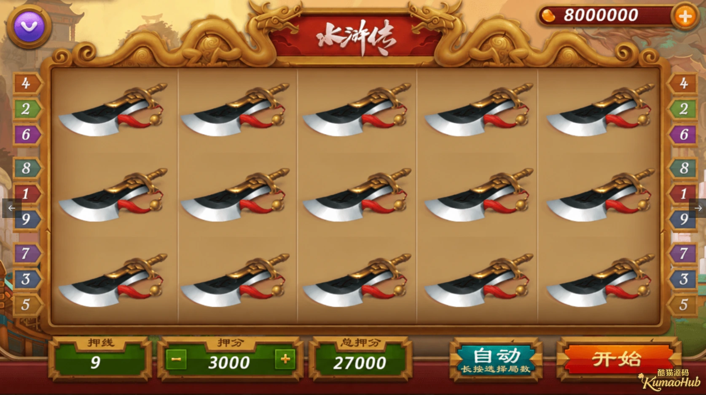
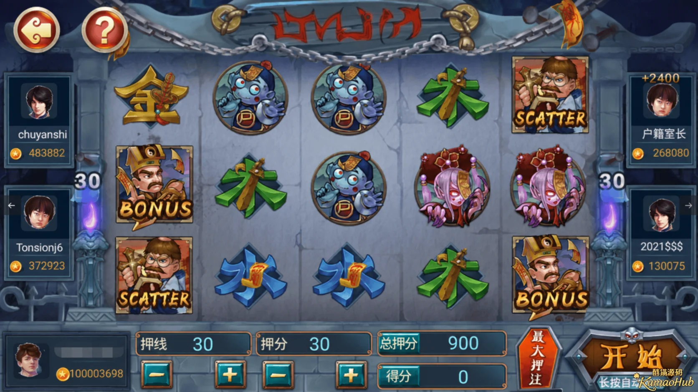

# 网狐系列911电玩｜12款子游戏与大厅功能介绍

911电玩属于网狐系列项目，包含僵尸风云、金瓶梅、万炮捕鱼、财神驾到等12款子游戏。大厅采用横向切换的双排布局，将子游戏入口与邮件、银行、设置等公共功能集中在一起。

本文介绍项目的玩法组成、大厅功能，以及多线游戏中线数、单线分值和总分的关系。

## 游戏大厅

大厅以海岛沙滩为主题，子游戏使用独立图标和中文名称。双排入口支持横向切换，同一大厅可以容纳不同类型和主题的游戏。

账号信息、金币数值和公告栏位于大厅顶部，邮件、银行和设置位于底部，另设龙虎榜入口。公共功能与子游戏入口分开排列，切换大厅内容时仍能找到常用功能。


## 子游戏

| 序号 | 游戏名称 | 序号 | 游戏名称 |
| --- | --- | --- | --- |
| 1 | 僵尸风云 | 7 | 秘鲁传说 |
| 2 | 金瓶梅 | 8 | 水浒传 |
| 3 | 万炮捕鱼 | 9 | 水果玛丽 |
| 4 | 财神驾到 | 10 | 五龙传说 |
| 5 | 水果拉霸 | 11 | 大话西游 |
| 6 | 跳高高 | 12 | 三打白骨精 |

各子游戏保留自己的主题美术与操作界面。水浒传采用金色边框和古典人物题材，僵尸风云采用夜景、符纸和僵尸题材；两者都以多列图标组成主要游戏区域。

## 水浒传

水浒传采用5列、3行的图标区域，左右两侧设置线路编号。底部依次提供押线、押分、总押分、自动和开始操作，分值通过加减按钮调整。



线数表示参与本轮计算的线路数量，单线分值表示每条线使用的分值。在按线数计分的设计中，本轮总分由两者相乘得到。例如，9条线、每线3000分，对应的总押分为27000。

线路编号与图标列数是两个不同概念：5列描述图标区域的宽度，9条线描述参与计算的线路数量，不能直接用列数代替线数。

## 僵尸风云

僵尸风云同样采用5列、3行布局，符号包含人物、僵尸以及 BONUS、SCATTER 等元素。两侧设置玩家信息区域，底部提供押线、押分、总押分、得分、最大押注和开始操作。



本例的押线为30、押分为30，总押分为900。总押分记录本轮使用的分值，得分记录结果，两项数据应分别表达，避免将投入与结果混为一项。

BONUS 与 SCATTER 是符号名称，其触发条件和计算方式由具体玩法规则决定，不能仅凭名称套用其他游戏的规则。

## 分值计算

按线数计分时，基础关系为：

```text
总押分 = 有效线数 × 单线分值

水浒传：   9 × 3000 = 27000
僵尸风云：30 ×   30 =   900
```

在界面开发中，线数或单线分值发生变化时，总分显示应同步更新。总分可作为派生值计算，避免分别保存三个数值后出现不一致。

界面展示与结果计算也应区分。图标动画负责表现过程，规则逻辑负责确定结果；自动操作改变的是操作方式，不应另设一套不同的计分规则。

## 技术交流

交流方向包括多游戏大厅布局、主题资源组织、分值联动与游戏界面开发。

Telegram：[@root4433](https://t.me/root4433)

仅供技术学习与交流，禁止用于赌博等违法活动。代码及素材的使用和传播应遵守相应授权。
